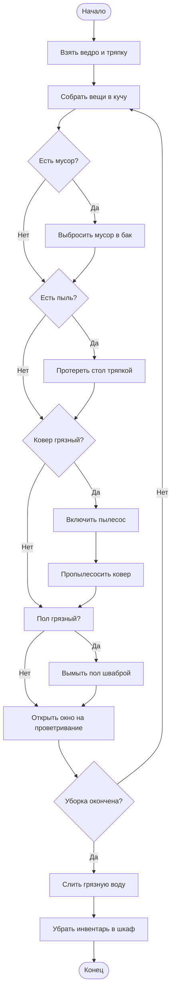
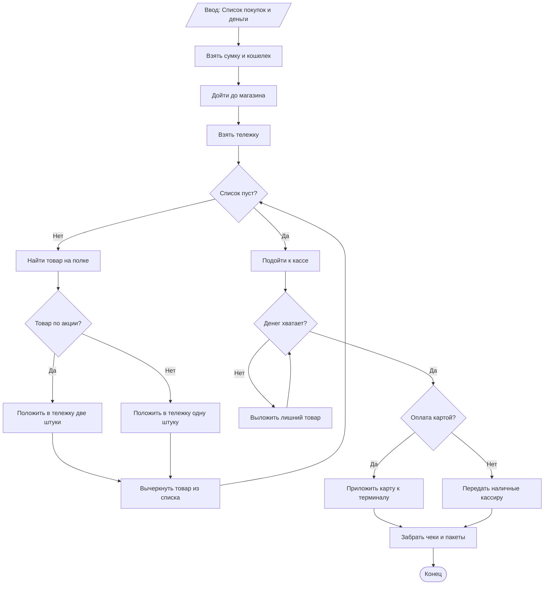
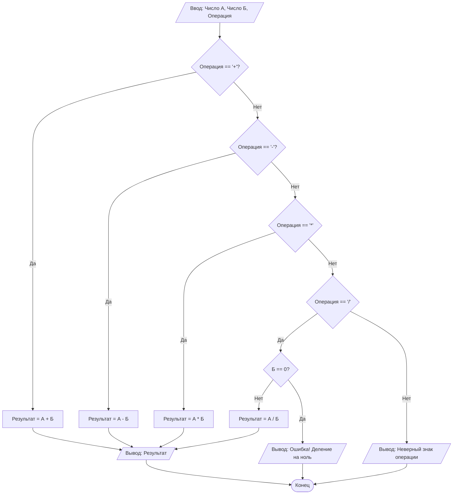
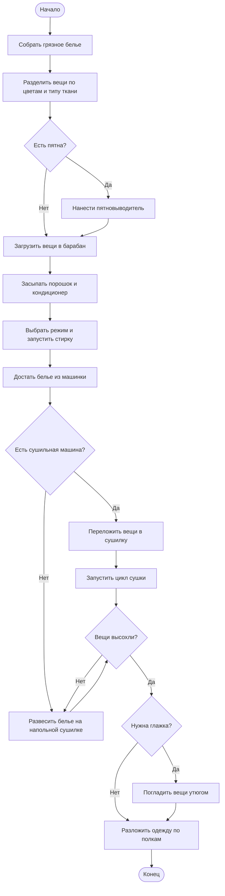

#  Блок-схемы алгоритмов

## 1. Блок-схема«Уборка в комнате»

## 2. Блок-схема «Поход в магазин»

## 3. Блок-схема «Калькулятор арифметических операций»

## 4. Блок-схема «Стирка и сушка одежды»
